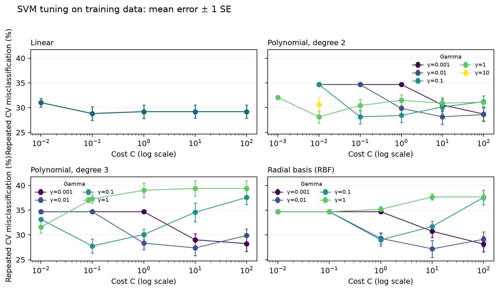

# Heart disease SVM analysis

**Selected:** LINEAR SVM (C=0.1). Repeated-CV error: 28.8% +/- 1.4% SE. The chosen model is the simplest candidate within one SE of the minimum mean CV error.

## Data and selection

The dataset has 462 observations and 9 predictors. CHD prevalence is 34.6% (160 cases; 302 non-cases), with 0 missing cells and 83 rows having at least one 1.5-IQR predictor outlier. This moderate-sized, nine-predictor binary classification task is reasonable for SVM comparison. Predictors were standardized within each training fold. A stratified 25% test set was held out with seed 432; training-set selection used 5-fold CV repeated 3 times.

Candidates were linear (simple baseline), RBF (smooth flexible boundary), and degree-2/3 polynomial (low-order interactions). Base C grid: 0.01, 0.1, 1, 10, 100; base RBF/polynomial gamma grid: 0.001, 0.01, 0.1, 1; polynomial coef0=1. Two extra quadratic settings checked the prior boundary result (C=0.001 at gamma=1; gamma=10 at C=0.01). The table shows the best setting per kernel/degree; SE is the sample standard deviation of its 15 fold errors divided by the square root of the fold count.

| Kernel family         | Best parameters                     | Mean CV error ± SE   |   Support vectors | Selection   |
|:----------------------|:------------------------------------|:---------------------|------------------:|:------------|
| Linear                | C=0.1                               | 28.8% ± 1.4%         |               216 | CHOSEN      |
| Polynomial (degree 2) | C=0.01, degree=2, gamma=1, coef0=1  | 28.1% ± 1.3%         |               209 |             |
| Polynomial (degree 3) | C=10, degree=3, gamma=0.01, coef0=1 | 27.4% ± 1.5%         |               207 |             |
| RBF                   | C=10, gamma=0.01                    | 27.2% ± 1.7%         |               210 |             |

## Test evaluation

Test misclassification rate: 25.9% (30/116). Confusion matrix (actual rows 0,1; predicted columns 0,1): `[[65, 11], [19, 21]]`. FP=11; FN=19; sensitivity=52.5%; specificity=85.5%.

For CHD screening, false negatives may be costlier because missed cases could delay follow-up; false positives can lead to unnecessary assessment. This comparison uses the default classification threshold. The selected fit has 216 support vectors (62.4% of training cases). A linear kernel gives a linear boundary in the standardized predictor space. The range between the best and worst family-level CV errors was 1.6 percentage points; treat CV differences in light of their fold-level SEs. Results are predictive rather than causal; the selected kernel does not support simple individual-effect interpretation.

**Artifacts:** `analyze_svm.py` contains the complete analysis; `cv_results.csv` has all 67 candidate settings and fold-level results; `summary.json` contains the computed summary; `cv_tuning.png` is the tuning figure. The test set was evaluated once after selection.
